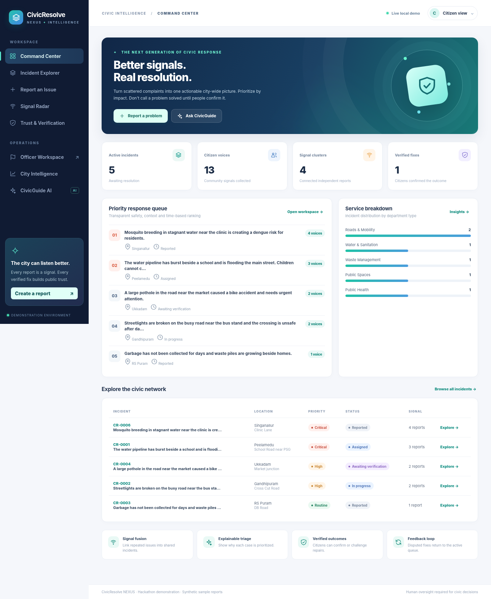
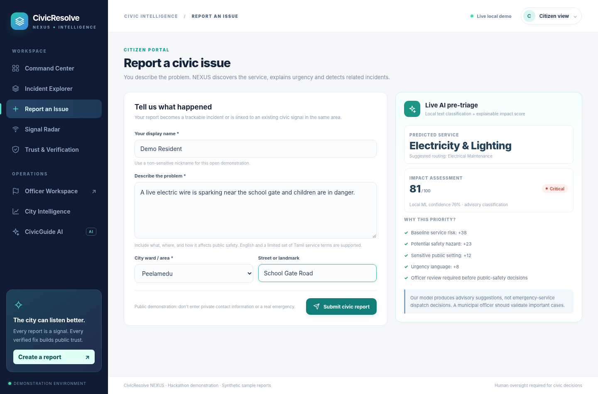
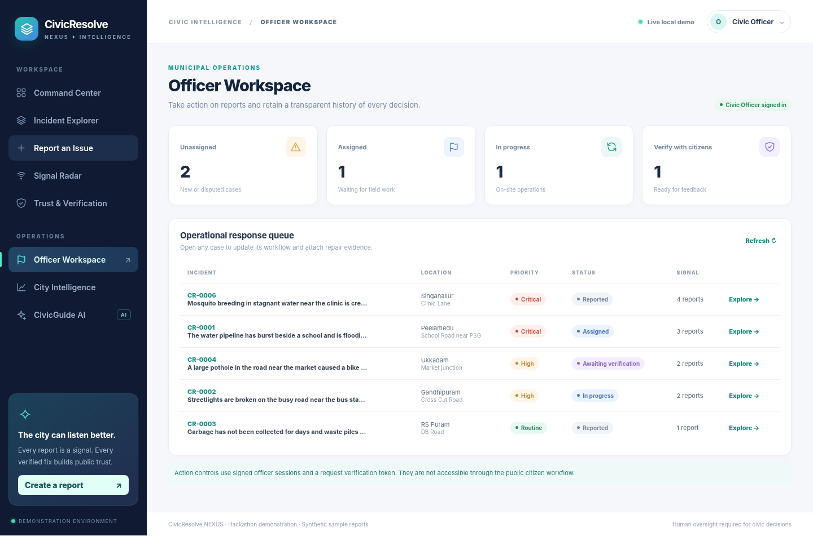
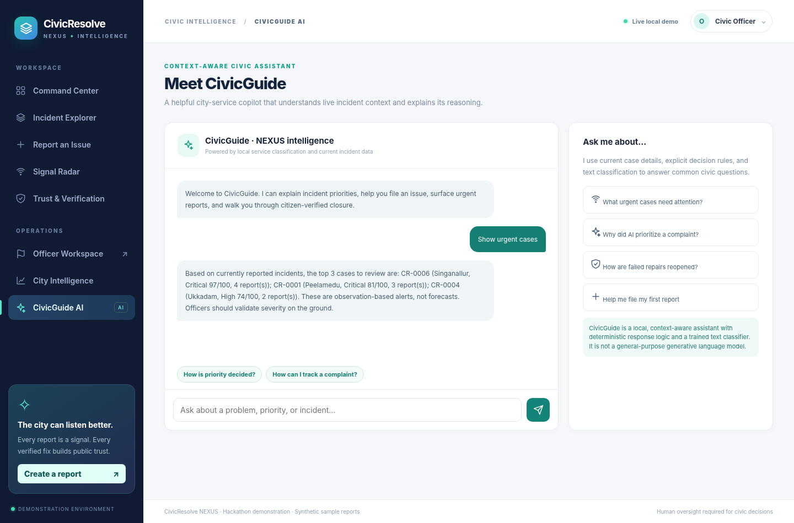

# CivicResolve NEXUS — Civic intelligence, verified impact

> **Hackathon vertical:** CivicResolve: AI-Powered Citizen Grievance Management and Resolution  
> **Innovation:** A closed-loop civic incident network that consolidates citizen signals, explains prioritization, and requires citizen feedback before treating repairs as verified outcomes.  
> **Project status:** Functional hackathon demonstration. It uses **synthetic/sample incidents** and is **not an official municipal service**.

## The vision

Existing complaint portals can easily become collections of isolated tickets. A dashboard may say a job is "closed" even when residents still experience the problem. NEXUS reframes civic service around **shared incidents and verifiable public outcomes**, not just ticket throughput.

**The NEXUS loop:**

1. **Listen.** Citizens report a problem by text, locality and optional landmark.
2. **Understand.** A locally trained character n-gram text classifier suggests a department. A transparent impact formula considers safety language, vulnerable settings, independent reports and how long the problem has waited.
3. **Connect.** A conservative matching heuristic can attach another report to the same incident in the same area, category and similar location rather than creating a second ticket.
4. **Act.** An officer signs in, assigns responsibility, records field work and can upload repair photo evidence.
5. **Verify.** An original reporter confirms the repair or disputes it. **A dispute reopens the case** for further action.
6. **Learn from signals.** The command center observes growing complaint clusters and highlights matters requiring human review. The system is **not a trained predictive-forecasting engine**.

The result is a demo with an explicit public-trust feedback loop, not simply an AI chatbot attached to a complaint form.

## Novelty that judges can test

| Capability | What makes it distinct | Demonstration |
|---|---|---|
| Civic Signal Fusion | Combines multiple citizen observations into one incident, while preserving each reporter's evidence | Submit the same report twice under distinct aliases, same ward and landmark; observe one incident with two voices |
| Explainable Impact Intelligence | Prioritization makes the supporting factors visible, caps the influence of popularity and escalates overdue cases | Type a hazardous vs ordinary description into Live AI pre-triage; inspect the reasoning |
| Proof-of-Resolution | "Assigned" and "in progress" are **not** the same as "verified resolved" | Move a case to verification, dispute it as a reporter, and watch it reopen |
| Civic Early-Warning Radar | Surfaces observed clusters and urgent reports that staff should investigate | Open Signal Radar after corroborating an incident |
| Contextual CivicGuide | Uses the current incident database and explainable decision rules to answer workflow and priority questions | Ask "Show urgent cases", "How is priority decided?" or why a selected incident is high priority |

**Scientific honesty:** The novelty is the integrated workflow and operational design. We are **not claiming to be the first system globally** to use any individual technique. We have **not measured** accuracy, real-world effectiveness, safety improvement, or public-sector fairness against a representative benchmark.

## Eight views

- **Command Center:** public overview, queues, service distribution and leading signals
- **Incident Explorer:** searchable/filterable cases, timelines, area and status
- **Report an Issue:** validated citizen intake and live ML triage suggestions
- **Signal Radar:** observed clusters, urgency indicators, source-based warnings
- **Trust & Verification:** the citizen audit and dispute/reopen loop
- **Officer Workspace:** authenticated municipal workflow controls
- **City Intelligence:** service, ward, closure and population-of-reports analytics
- **CivicGuide AI:** local, dynamic, contextual service assistant

## Screenshots from the hackathon demo interface

The images below are browser-rendered UI previews using synthetic local API fixture responses, not screenshots from a publicly hosted app. Features and API transitions are also covered by the automated workflow tests.

**Command center**



**Live AI-assisted triage**



**Officer workspace**



**Contextual CivicGuide assistant**



## Tech stack and implementation

- Python 3.12+, FastAPI, SQLAlchemy 2.x and Pydantic v2
- SQLite for local/demo use; PostgreSQL supported through `DATABASE_URL`
- scikit-learn TF-IDF character n-grams + Multinomial Naive Bayes for multiclass category suggestion. Six service classes plus fallback; small manually created in-repo examples.
- Python rules + fuzzy similarity for explainable urgency scoring and incident matching
- HTML, CSS and plain JavaScript: responsive, no frontend framework build tools or remote assets
- Session-signed demo login, server-side officer-role gate, CSRF check for staff mutations, validation and file signature checks

**AI transparency:** The text classifier is an actual locally trained lightweight ML model, retrained from in-repo examples on first inference. The urgency scorer, duplicate linking and CivicGuide response selection are deliberately **rules-based**, not LLM reasoning. No internet API or Gemini/OpenAI key is necessary. Predictions and scores are *advisory*; no automatic emergency dispatch is implemented.

## Quick start on Windows (PowerShell)

Prerequisites: Python 3.12 or newer, Git and a browser.

```powershell
cd CivicResolve-NEXUS
py -3 -m venv .venv
.\.venv\Scripts\Activate.ps1
python -m pip install -r requirements.txt
python -m uvicorn app.main:app --reload --port 8000
```

Open **http://localhost:8000**. You may also run `run_windows.bat` from Command Prompt. If PowerShell blocks script activation, run `.\.venv\Scripts\python.exe -m uvicorn app.main:app --reload --port 8000` directly.

## Quick start on Ubuntu, WSL or macOS

```bash
cd CivicResolve-NEXUS
python3 -m venv .venv
source .venv/bin/activate
python -m pip install -r requirements.txt
python -m uvicorn app.main:app --reload --host 127.0.0.1 --port 8000
```

The app automatically populates an empty database with six clearly fictional demonstration incidents. The DB file (`civicresolve.db`) and uploads are git-ignored.

### Demo credentials (hackathon showcase only)

| Role | Email | Password |
|---|---|---|
| Officer | `officer@nexus.demo` | `NexusDemo#2026` |
| City administrator | `admin@nexus.demo` | `NexusDemo#2026` |

Click **Citizen view** in the top right to sign in. These are **public showcase credentials**: do not deploy this demo against real citizen data or assume these credentials protect a production service. To change the demo password, set `DEMO_PASSWORD` in the hosting environment. The UI displays the default demo credential, so when changing the password provide it privately to judges instead. The public citizen interface needs no login.

For cloud deployment, set `SESSION_SECRET` to a long randomly generated secret and `COOKIE_SECURE=true` on HTTPS. `DEMO_MODE=false` disables public demo accounts; full production identity management is **not implemented** and would need to be added before municipal use.

### How to reproduce the full test story

1. **Citizen:** Open Report an Issue, enter `Sample Citizen`, choose `Town Hall` and describe a burst water pipe near `Demo School Lane`. Observe the AI predicted category and risk explanation. Submit. Save the resulting `CR-xxxx` code.
2. **Signal fusion:** Re-submit the same description, ward and landmark with the alias `Another Citizen`. The second observation should join the same incident.
3. **Staff:** Log in as an officer and open that incident in the Officer Workspace. Assign it, start work and submit a repair explanation for citizen verification. Optionally attach a valid image during work.
4. **Citizen verification:** Open the incident and enter `Sample Citizen` as the reporter. Choose **Dispute**; observe the case reopen. The officer can repeat the action cycle and the reporter can then **Confirm** to close the new resolution round.
5. **Assistant:** Ask CivicGuide to show urgent cases and explain the prioritization method. Examine Signal Radar and City Intelligence for the changed counts.

## API overview

| Endpoint | Method | Who | Purpose |
|---|---|---|---|
| `/api/health` | GET | Public | Health readiness |
| `/api/overview` | GET | Public | Aggregates, queue and observed alerts |
| `/api/incidents` | GET | Public | List/filter incidents |
| `/api/incidents/{id}` | GET | Public | Full timeline and citizen feedback |
| `/api/triage` | POST | Public | Live NLP classification and risk preview |
| `/api/complaints` | POST | Public | New/merged reports |
| `/api/incidents/{id}/support` | POST | Public | Corroborate an issue |
| `/api/assistant` | POST | Public | Dynamic context-aware CivicGuide |
| `/api/auth/login` | POST | Demo staff | Signed staff session |
| `/api/auth/me` | GET | All | Session role and CSRF |
| `/api/incidents/{id}/action` | POST | Officer + CSRF | Workflow transitions |
| `/api/incidents/{id}/evidence` | POST | Officer + CSRF | Attach image evidence |
| `/api/incidents/{id}/verify` | POST | Demo reporter alias | Confirm/reopen the current repair round |

Interactive Swagger/OpenAPI explorer: **http://localhost:8000/docs**. JSON schema: `/openapi.json`.

## Logic and assumptions

- Category predictions come from a small demonstration training corpus embedded in `app/triage.py`. It is not an authoritative Tamil/English municipal model. Tamil support is limited to the included examples and keywords.
- The public safety score starts with a service-category baseline, adds **+23** for hazard phrases, **+12** for sensitive locations, **+8** for urgency language, up to **+12** for corroboration and up to **+20** for age in 6-hour increments, capped at 100. These are **heuristic prototype weights**, not statistically validated impact measurements.
- Matching only links active incidents in the same ward and category, with loosely matching landmarks and text similarity above the conservative prototype threshold. There will be false positives and negatives; human review is needed.
- Each reporter chooses a display alias; no robust civic ID or address verification is implemented. Only an alias already linked to a complaint may confirm it, but it is **not identity authentication**.
- The first reporter confirmation closes a repair round; the first dispute reopens it. This is a demonstration policy, **not** a robust consensus/appeals system. There are no formal SLAs.
- The demonstration data is synthetic and created at startup for an empty DB, labelled as such in the application. **No city agency approved these incidents or uses this application.**
- SQLite uses local disk; many free cloud platforms delete local data when instances restart. For persistent use, configure PostgreSQL and durable object storage.

## Run tests

```bash
python -m pytest -q
```

The integration suite exercises CRUD read paths, classification and priority rules, report fusion, staff-role and CSRF checks, unauthorized attempts, the complete assign→repair→dispute→reopen→confirm path, conversational assistant logic, upload format checks and validation. **8 tests passed** in the packaged development environment. If test tools are missing, install `pip install -r requirements-dev.txt` first.

## Deployment

**Option A — Render (GitHub linked):** push the repo and choose **New → Blueprint**, using `render.yaml`, or choose **New Web Service** and point it to your public GitHub repository. For Render, the default demo uses SQLite stored in an ephemeral filesystem; data may reset on new instances. Deploying creates an external URL, but **no URL is created by this ZIP**.

**Option B — Docker / Google Cloud Run:**

```bash
docker build -t civicresolve-nexus .
docker run --rm -p 8080:8080 -e SESSION_SECRET=replace-with-a-long-secret civicresolve-nexus
```

Open http://localhost:8080. Google Cloud Run can run this Dockerfile, but Cloud Run's filesystem is ephemeral. Configure `DATABASE_URL` pointing to a durable PostgreSQL instance for persistence. To store images persistently on Cloud Run, replace local image uploads with a secure object-store integration.

**Operational caution:** For any public real-world launch, do **not** treat these demo accounts as secure identity management. Production requires authenticated citizen accounts, delegated officer permissions, audited role provisioning, anti-spam throttling across workers, data retention/consent and privacy processes, durable media storage and a security review.

## GitHub / hackathon compliance

The provided package contains only source, tests and documentation—no model binary, database, virtual environment, cached packages or dataset. It is far below the 10 MB repo limit. Use **exactly one `main` branch**. In the portal paste the GitHub **clone URL ending in `.git`**, not the browser URL.

See:

- [`docs/SUBMISSION_CHECKLIST.md`](docs/SUBMISSION_CHECKLIST.md): each organizer requirement mapped to concrete actions
- [`docs/DEMO_SCRIPT.md`](docs/DEMO_SCRIPT.md): five-minute demonstration
- [`docs/PROJECT_PITCH.md`](docs/PROJECT_PITCH.md): short description and novelty statement
- [`docs/LINKEDIN_POST.md`](docs/LINKEDIN_POST.md): publishable LinkedIn caption
- [`docs/SECURITY_AND_LIMITATIONS.md`](docs/SECURITY_AND_LIMITATIONS.md): safety and future work
- [`docs/ARCHITECTURE.md`](docs/ARCHITECTURE.md): system structure and reasoning logic

## Project structure

```text
CivicResolve-NEXUS/
├── app/
│   ├── main.py                 # API, workflow, session/access control, service assistant
│   ├── database.py             # SQLAlchemy schema and database connection
│   ├── triage.py               # Classifier, impact scoring and conservative similarity
│   └── static/
│       ├── index.html          # Semantic, responsive page shell
│       ├── app.js              # Citizen, officer, guide, incident and analytic UX
│       ├── style.css           # Responsive styling and accessible controls
│       └── favicon.svg
├── tests/test_workflows.py     # 8 integration/unit tests
├── docs/                       # Pitch, submission, demo, screenshots and risk notes
├── .env.example                # Config reference (no actual secrets)
├── .gitignore                  # Data/assets/caches excluded
├── Dockerfile                  # Container deployment
├── render.yaml                 # Render blueprint
├── requirements.txt            # Runtime dependencies
├── requirements-dev.txt        # Tests and local HTTP client
└── README.md
```

## Evaluation mapping

| Evaluation criterion | Evidence in this repository |
|---|---|
| Code quality | Structured ML, data and API modules; small client with escaped output; documentation |
| Security | Signed staff sessions, CSRF checks, input length limits, MIME/magic checks, CSP, no secret files committed |
| Efficiency | Compact repository, local inference, no paid APIs or frontend build pipeline, capped report score |
| Testing | 8 passing API/model tests, reproducible demo script |
| Accessibility | Labels, keyboard activation for incident cards, focus states, screen-reader status messages, reduced-motion support, responsive layouts |
| Problem alignment | Complaint intake, AI-assisted classification, contextual assistance, routing, status tracking and transparent closure |

## Important disclaimer

This is an engineering proof-of-concept intended for a hackathon and educational purposes, not a municipality-backed or emergency response product. Prioritization and routing can be incorrect. If someone encounters an immediate safety threat, they should contact relevant local emergency services directly instead of relying on this application.
