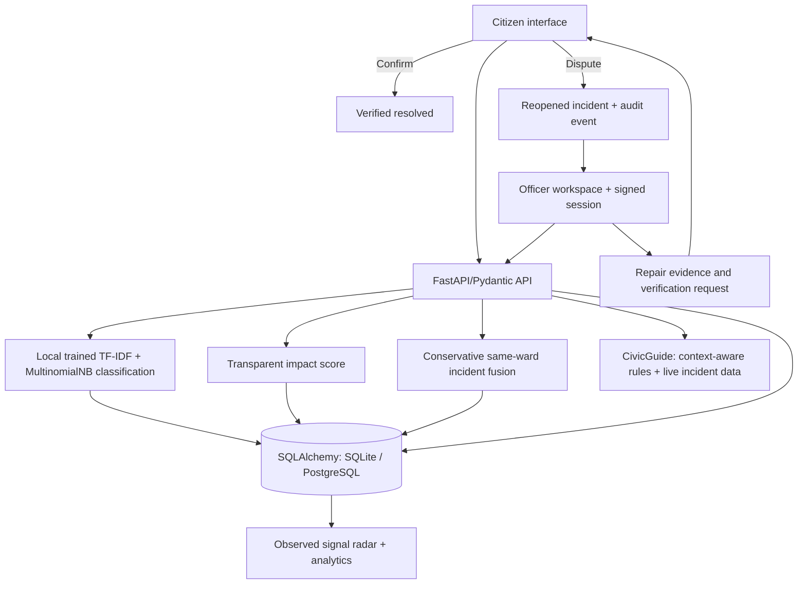

# System architecture and decision logic

## Data entities

- **Incident:** shared problem, location, responsible service, priority, status, and resolution round.
- **Report:** individual citizen observation tied to one shared incident (alias, description, timestamp).
- **Event:** auditable state changes such as reported, assigned, started, evidence, verification, confirmed or disputed.
- **Verification:** confirmation or dispute for a specific incident resolution round, associated with the reporting alias.

## Category logic

`app/triage.py` contains labeled synthetic phrases for six civic categories: water, roads, waste, lights/power, health and public spaces. It trains a character n-gram TF-IDF + Multinomial Naive Bayes classifier in-process on first call. Simple domain vocabulary can override an obviously weak suggestion; out-of-domain cases fall back to general civic service. Confidence is model-derived and uncalibrated.

## Priority logic

`min(100, service_baseline + (23 if hazard) + (12 if sensitive_setting) + (8 if urgent) + min(12, 4 * (reports - 1)) + min(20, floor(hours_waited / 6)))`.

- **Critical**: ≥78; **High**: ≥60; **Moderate**: ≥40; otherwise **Routine**.
- The weights are demonstration policy choices and are not validated against outcomes. Public safety classifications are advisory and require human review.
- Signal score increases over time while an issue remains open, recalculated at read time.
- Report count adds at most 12, limiting simple crowd/popularity dominance.

## Fusion logic

Existing open incidents are compared only when their ward and service category match. If landmarks are supplied, they must be reasonably similar before text similarity is evaluated. The combined similarity uses token Jaccard overlap (70%) and `difflib.SequenceMatcher` character similarity (30%); a threshold of 0.48 chooses a candidate. False matches and missed matches remain possible; human deduplication review is future work.

## Contextual assistant

The assistant endpoint handles common intents: how to submit, how the score works, urgent cases, verification/reopening and a specific incident's status/score. It reads the current database when answering queue/incident questions. It returns a compact answer and follow-up suggestions. It is a **deterministic service assistant with a trained classification module**, not a general-purpose chatbot using GPT/Gemini or a policy decision-maker.

## Staff security boundary

Officer writes require a signed cookie-based session and a session-specific `X-CSRF-Token`, role gates, and workflow transition validation. Public reporting and retrieval don't require staff sign-in. Public resident-verification aliases are **not real identity proof**. Public demo users deliberately share sample staff credentials, so this isn't production-grade access management. Media file uploads validate size, allowed MIME and byte signatures.

## Data retention and deployment notes

The sample SQLite database is created at startup and deliberately excluded from Git. For free stateless hosting, the sample may reset. For persistent operations, use PostgreSQL via `DATABASE_URL`; repair media also needs durable object storage. Add formal backups, database migrations, consent/retention rules, access logging, cross-worker abuse limits and real identity management before real civic use.
